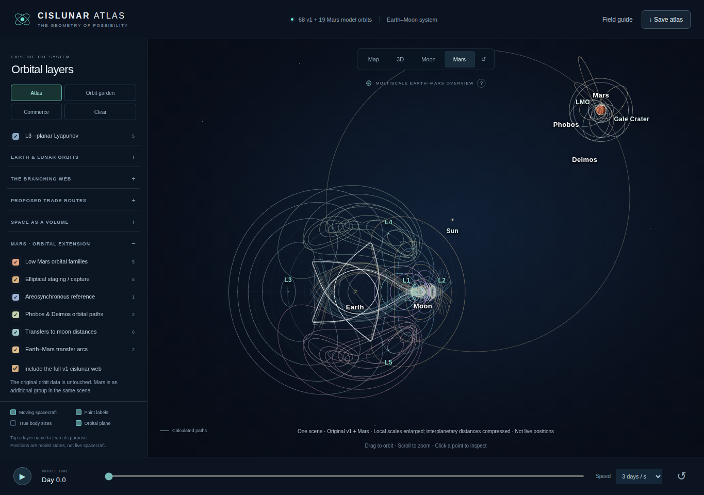

# Cislunar Atlas v2 — Original v1 + Mars

**The original atlas has been recovered and extended, not rebuilt.** The complete working v2 application is now [`index.html`](index.html). An untouched copy of the original application is retained at [`vendor/v1/original.html`](vendor/v1/original.html).

## Get the application

**[Download the complete v2 HTML](https://github.com/JonErnster/Cislunar-Economy/raw/refs/heads/main/index.html)** and open the downloaded file in a desktop browser. The renderer, textures, orbit data, and explanations are embedded; no build or external libraries are needed to use it.

[View the publication commit](https://github.com/JonErnster/Cislunar-Economy/commit/d5a104d0f7bb01548fd1dfbef6da0d2590505ad9) · [View the successful build and tests](https://github.com/JonErnster/Cislunar-Economy/actions/runs/41525843877) · [Browse the Mars extension source](src/mars-extension.js)



## What changed

**Map remains the default.** The original Map, 3D, and Moon camera modes, original orbital catalog, textures, colors, and original stylesheet are retained. The Wide button is now **Mars**.

Clicking Mars smoothly pulls back the original camera to show the original cislunar orbital web toward the lower-left and the Mars orbital neighborhood toward the upper-right, together in one continuous scene. It does not switch to a replacement supply-chain diagram or load a second visualization in an iframe.

A new **Mars · Orbital Extension** category adds low Mars orbits, elliptical staging examples, an areosynchronous reference, Phobos and Deimos orbital paths, transfers to moon orbital distances, and ideal Earth–Mars transfer arcs. Layer names open the existing inspector with descriptions and equations. Returning to Map restores the original cislunar layer selections and framing.

The Mars overview initially includes the full numerical v1 cislunar web. Its checkbox can instead retain only the user's previously selected v1 layers.

## What is preserved

The recovered standalone v1 contains **71 orbit records and 96 manifold branches**. Its embedded orbital-data script and original stylesheet are preserved byte-for-byte in v2. The same scene, renderer, camera, controls, and timeline draw the added Mars objects.

The builder verifies the complete original's SHA-256 before applying three narrowly targeted edits. It also removes the original host's injected Cloudflare challenge script, which is hosting infrastructure rather than atlas code.

- Original v1 SHA-256: `65cc0daae9f72ffc30d9ba9f6996c3c5c143be8ca15f69b3c79fab50fa711be6`.
- Published v2 SHA-256: `59bd258352723eaf8dc2746fb56b08f08350c6ce52b7b2231ea6defa4ead370b`.
- [Build and byte-preservation report](docs/build-verification.json).
- [Browser and numerical test results](docs/browser-verification.json).
- [Recovery provenance](v1-recovery-report.json).

## Physics and display limits

The original Earth–Moon CR3BP trajectories remain unchanged. The addition contains **19 analytic Mars-centered two-body reference orbits** and **two ideal Sun-centered Hohmann half-ellipse arcs**. These are calculated model examples, not live spacecraft positions or date-specific mission trajectories.

The combined view is deliberately **multiscale**: each local orbital neighborhood is enlarged and the Earth–Mars separation is compressed. It is not a single globally scaled Earth–Moon–Sun–Mars integration. The transfer arcs refer to departure and arrival at different epochs. Intersections do not establish rendezvous, and the moon-distance reference ellipses do not solve capture, landing, target phasing, or mission optimization. The Mars globe is a procedural illustration rather than a geographic map.

Primary references used for the Mars extension include [JPL astrodynamic constants](https://ssd.jpl.nasa.gov/astro_par.html), [mean satellite elements](https://ssd.jpl.nasa.gov/sats/elem/), [satellite physical parameters](https://ssd.jpl.nasa.gov/sats/phys_par/), and [planetary physical parameters](https://ssd.jpl.nasa.gov/planets/phys_par.html). Original v1 provenance and model explanations remain embedded in the application.

## Verification

GitHub Actions successfully built the app and ran Chromium checks at 1365×960, 390×844, and 320×740. These checked the default Map view, original orbit counts, Mars activation, Earth-lower-left/Mars-upper-right orientation, inspector equations, restoration of exposed v1 state, original 3D/Moon views, JavaScript errors, and horizontal overflow. The tested Kepler states conserve two-body specific energy to a maximum relative error of approximately `6.4e-15`.

These are Chromium checks, not a claim of testing every browser or device. The app retains v1's renderer fallback.

## Website hosting status

**The application and source are published in this repository. GitHub Pages has not been deployed.** The automated attempt to enable Pages was denied with `Resource not accessible by integration`. A separate external preview attempt also returned HTTP 403; no unverified preview is advertised as live.

The owner can enable branch-based hosting under [Settings → Pages](https://github.com/JonErnster/Cislunar-Economy/settings/pages): choose **Deploy from a branch → main → / (root)**. The root already contains the complete app and `.nojekyll`. After GitHub confirms successful deployment, use the website address GitHub displays. The earlier ChatGPT-hosted v1 has not been modified.

## Reproduce the build

```sh
python tools/build_v2.py
```

To repeat the browser checks:

```sh
python -m pip install playwright
python -m playwright install --with-deps chromium
python tests/check_browser.py
```

`src/mars-extension.js` is readable JavaScript. `tools/build_v2.py` performs the checksum-guarded insertion into the recovered original bundle. `vendor/v1/original.html` must not be edited. The generated `index.html` is the standalone deliverable.

This is an independent educational visualization, not an official NASA, JPL, Blue Origin, or U.S. government product and not a flight-navigation tool.
