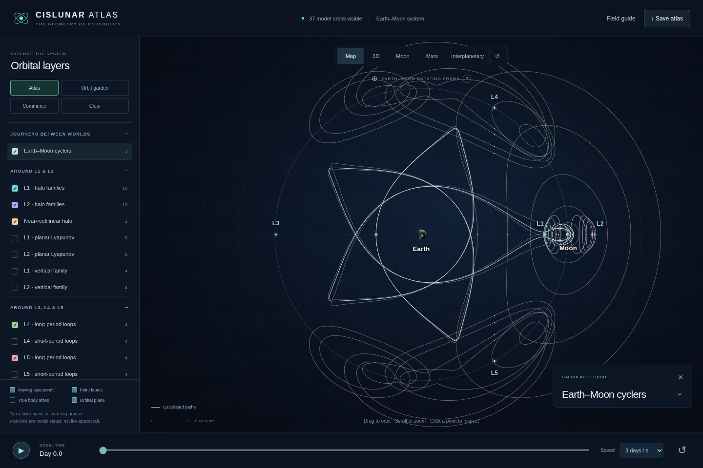
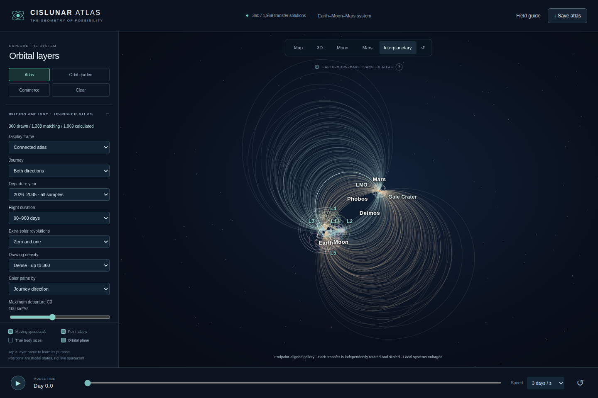

# Earth–Moon–Mars Atlas

[](https://jonernster.github.io/Cislunar-Economy/)

**[▶ LAUNCH THE INTERACTIVE ATLAS](https://jonernster.github.io/Cislunar-Economy/)**

Explore the orbital geometry and possible transport infrastructure of the Earth–Moon–Mars system. Rotate the scene, animate markers, choose orbital layers, and inspect the equations and tradeoffs behind the paths.

## V1 — Cislunar

V1 maps Earth, the Moon, all five Earth–Moon Lagrange points, halo and Lyapunov families, near-rectilinear halo and distant retrograde examples, repeating Earth–Moon cyclers, and approach and departure manifolds.

The catalog contains **71 orbit records and 96 manifold branches**. Map is the opening view. The 3D and Moon views explore the same geometry from other perspectives. Volume overlays describe the cislunar environment. Apollo, Glaser, and O’Neill layers illustrate proposed logistics corridors.



## V2 — Mars

V2 adds the Martian orbital neighborhood. **Mars** shows the cislunar orbital web toward the lower-left and Mars toward the upper-right in one scene.

The Mars layers contain **19 calculated two-body reference orbits** and two ideal Earth–Mars Hohmann transfer examples. They include low Mars orbits, elliptical staging orbits, an areosynchronous reference, Phobos and Deimos orbital paths, and transfers to their orbital distances.

## V3 — Earth–Moon–Mars

V3 adds **1,969 calculated interplanetary transfer solutions**: **978 outbound**, **991 inbound**, including **443 solutions with an additional complete solar revolution**. The catalogue samples departure dates during 2026–2035 and 15 flight durations from 90 to 900 days.

The **Interplanetary** button opens a dense transfer gallery while keeping the local Earth–Moon and Mars orbital neighborhoods visible. Use **Solar frame** to examine the same solutions in a shared Sun-centered coordinate system. Filter by departure year, direction, travel time, departure energy, and zero or one extra revolution. Select a curve or a cell in the date-versus-duration energy grid to inspect a particular solution.



## Explore

| View | Description |
| --- | --- |
| **Map** | The default Earth–Moon overview. |
| **3D** | An angled, rotatable view of cislunar orbital families. |
| **Moon** | A closer view of the lunar neighborhood. |
| **Mars** | The cislunar and Martian orbital neighborhoods together. |
| **Interplanetary** | A dense catalogue of date-dependent outbound and inbound transfer solutions. |

Use the sidebar for layers and transfer filters. On a phone, tap **Layers**. Interplanetary drawing density offers **Representative**, **Dense**, and **Every matching solution**. To display the entire stored catalogue, select both directions, all years, all durations, both revolution counts, maximum C3 of 225, and Every matching solution. The initial view draws up to 360 paths for readability.

The transfer inspector shows departure and arrival dates, travel time, departure C3, arrival excess speed, and ideal parking-orbit injection and capture estimates. The energy grid is a finite sample, not an exhaustive launch-window optimizer. Download the filtered transfer records as JSON or a selected trajectory as CSV. Animated transfer markers show normalized flight progress across the display timeline, not simultaneous motion of every mission.

## The models

**Cislunar:** the Earth–Moon orbit families use the circular restricted three-body model, alongside identified reference orbits and conceptual logistics corridors.

**Mars:** local examples use analytic two-body mechanics. The V2 interplanetary examples are idealized Hohmann transfers.

**Interplanetary:** a universal-variable Lambert solver calculates prograde, Sun-only transfer legs between departure and arrival positions from JPL’s approximate planetary elements. Earth is represented by the Earth–Moon barycentre. Zero-revolution and, for the longer sampled durations, one-revolution solutions are included. Each retained trajectory is independently propagated with DOP853 and checked for endpoint closure, energy, angular momentum, and revolution count.

The stored envelope uses departure C3 ≤ 225 km²/s², arrival excess speed ≤ 16 km/s, and perihelion ≥ 0.35 AU. These thresholds are catalogue choices, not launch-vehicle capabilities. Departure dates are sampled every 30 days; flight durations are 90, 120, 150, 180, 210, 240, 270, 300, 330, 360, 420, 480, 600, 720, and 900 days. Date labels use midnight TDB without a UTC conversion. Display coordinates are rounded to 10⁻⁷ AU.

### Reading the two interplanetary views

**Connected atlas** is an endpoint-aligned comparison gallery. Each solved arc is rigidly rotated and uniformly scaled to connect the displayed local neighborhoods. Local systems are enlarged independently. It is not one common physical frame.

**Solar frame** uses a common heliocentric J2000 ecliptic frame and an AU distance scale. The curves depart at different epochs, so their endpoints are not simultaneous positions of the planets. The planetary reference curves are sampled near 2030.

The interplanetary legs are **not dynamically stitched** to the detailed lunar and Mars orbit examples. This version does not solve lunar escape matching, gravity assists, low-thrust propulsion, aerocapture, landing, recurring Earth–Mars cyclers, or complete round-trip missions. Parking-orbit burn estimates are ideal impulsive values for Earth at 200 km altitude and Mars at 400 km, without plane changes. Model-validation residuals are not real-world navigation accuracy. This is a finite sampled atlas, not every possible orbit or a flight-navigation tool.

## Sources

- [NASA/JPL periodic-orbit catalog](https://ssd-api.jpl.nasa.gov/doc/periodic_orbits.html).
- [JPL approximate planetary positions and accuracy](https://ssd.jpl.nasa.gov/planets/approx_pos.html).
- [JPL astrodynamic constants](https://ssd.jpl.nasa.gov/astro_par.html).
- [JPL satellite elements](https://ssd.jpl.nasa.gov/sats/elem/).
- [ESA description of Lambert’s problem](https://esa.github.io/pykep/lambert.html).

<details>
<summary>Downloads, development and validation</summary>

[Download the standalone HTML](https://github.com/JonErnster/Cislunar-Economy/raw/refs/heads/main/index.html). The visualization engine, textures and datasets are embedded, so the downloaded file can run offline in a modern desktop browser. The hosted site is the convenient option for phones.

The V1 application is in `vendor/v1/original.html`. Mars code is in `src/mars-extension.js`. V3 code is in `src/interplanetary.js`, and its numerical generator is in `tools/generate_transfers.py`.

```sh
python -m pip install -r requirements-v3.txt
python tools/generate_transfers.py
python tools/build_v3.py
python -m playwright install --with-deps chromium
python tests/check_v3.py
```

[Data and numerical checks](docs/v3-numerical-verification.json), [build checks](docs/v3-build-verification.json), and [browser checks](docs/v3-browser-verification.json) document the verification scope. The visual test compares the original Map drawing with navigation excluded because V3 has an additional button. Chromium checks cover desktop and 390-/320-pixel layouts, filters, equations, and restoration of the original Map state. They do not establish universal browser compatibility.

The launch button opens the repository’s GitHub Pages site. GitHub Pages serves `main` from the repository root.

</details>

This is an independent educational visualization, not an official NASA, JPL, MIT, ESA, Blue Origin, or U.S. government product.
