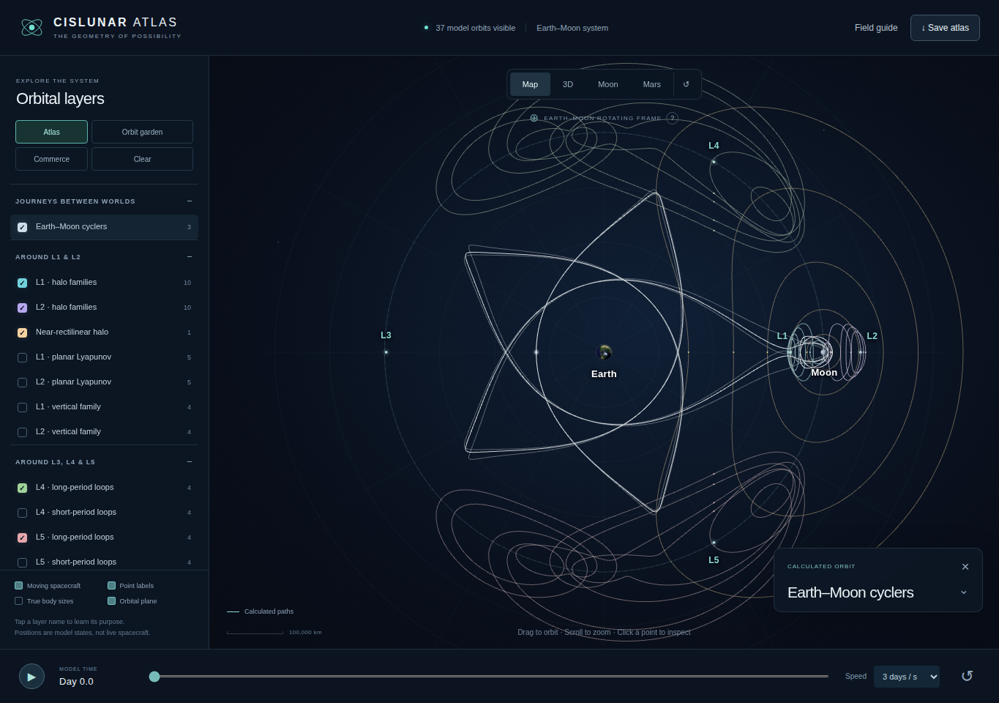

# Cislunar Economy

[](https://jonernster.github.io/Cislunar-Economy/)

**[▶ LAUNCH THE INTERACTIVE ATLAS](https://jonernster.github.io/Cislunar-Economy/)**

Explore the orbital geometry and potential transport infrastructure of the Earth–Moon–Mars system. Rotate the scene, animate spacecraft markers, switch orbital layers on and off, and inspect the equations behind the paths.

## V1 — Cislunar

V1 maps the Earth–Moon system: Earth, the Moon, all five Lagrange points, halo and Lyapunov orbit families, near-rectilinear halo and distant retrograde examples, repeating cyclers, and approach and departure manifolds.

Its catalog contains **71 orbit records and 96 manifold branches**. The Map, 3D, and Moon views explore the system from different perspectives. Volume overlays show the wider cislunar environment, while the Apollo, Glaser, and O’Neill layers illustrate proposed logistics corridors and their economic roles.



## V2 — Mars

V2 adds the Mars orbital neighborhood to the cislunar atlas. The **Mars** button pulls the camera back to show the Earth–Moon orbital web toward the lower-left and Mars toward the upper-right, together in one continuous scene.

The Mars layers include **19 Mars-centered two-body reference orbits** and **two ideal Earth–Mars transfer arcs**. Explore low Mars orbits, elliptical staging orbits, an areosynchronous reference, the orbital paths of Phobos and Deimos, and transfers to their orbital distances. Select a layer to read its purpose and equations.


## Explore

| View | Description |
| --- | --- |
| **Map** | The default Earth–Moon overview. |
| **3D** | An angled, rotatable view of the cislunar orbit families. |
| **Moon** | A closer view of the lunar neighborhood. |
| **Mars** | A combined overview of the cislunar and Martian orbital systems. |

Use the sidebar to choose layers and the timeline to pause or adjust the animation. Returning to Map restores the cislunar framing and selections. On a phone, open **Layers** to access the sidebar.

## The models

The Earth–Moon orbit families use the circular restricted three-body model, alongside clearly identified reference orbits and conceptual logistics routes. The Mars examples use analytic two-body mechanics; the interplanetary arcs are idealized Sun-centered Hohmann transfers.

The combined Mars overview is **multiscale**: local orbital neighborhoods are enlarged and interplanetary separation is compressed for readability. These are model examples, not live spacecraft positions or date-specific flight plans. Crossing paths do not by themselves establish a rendezvous. The commercial corridors are concepts, not uniquely solved mission trajectories.

## Sources

The application includes orbit provenance and model explanations. Primary references include the [NASA/JPL periodic-orbit catalog](https://ssd-api.jpl.nasa.gov/doc/periodic_orbits.html), [JPL astrodynamic constants](https://ssd.jpl.nasa.gov/astro_par.html), [satellite orbital elements](https://ssd.jpl.nasa.gov/sats/elem/), and [planetary physical parameters](https://ssd.jpl.nasa.gov/planets/phys_par.html).

<details>
<summary>Download, development, and hosting</summary>

### Download

[Download the complete atlas HTML](https://github.com/JonErnster/Cislunar-Economy/raw/refs/heads/main/index.html) and open it in a desktop browser. The renderer, textures, orbit data, and explanations are embedded in the file.

### Development

The Mars source is in [`src/mars-extension.js`](src/mars-extension.js). The V1 application is in [`vendor/v1/original.html`](vendor/v1/original.html).

```sh
python tools/build_v2.py
python -m pip install playwright
python -m playwright install --with-deps chromium
python tests/check_browser.py
```

[Build checks](docs/build-verification.json) and [browser checks](docs/browser-verification.json) document the numerical and interface tests.

### GitHub Pages

The launch button opens `https://jonernster.github.io/Cislunar-Economy/`.

To activate the website, open [Settings → Pages](https://github.com/JonErnster/Cislunar-Economy/settings/pages), select **Deploy from a branch**, choose **main** and **/ (root)**, and save. The button's destination becomes available after GitHub Pages is enabled and deployment succeeds.

</details>

This is an independent educational visualization, not an official NASA, JPL, Blue Origin, or U.S. government product or a flight-navigation tool.
